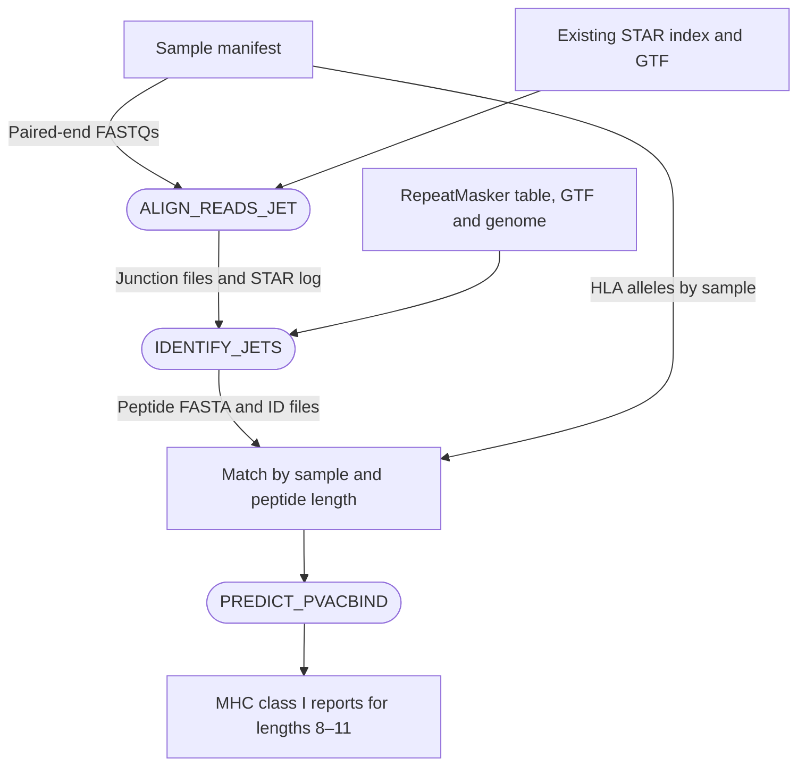

# NeonDisco-TEAL — JET Identification Pipeline V.2.1.0

```
  ███╗   ██╗███████╗ ██████╗ ███╗   ██╗██████╗ ██╗███████╗ ██████╗ ██████╗
  ████╗  ██║██╔════╝██╔═══██╗████╗  ██║██╔══██╗██║██╔════╝██╔════╝██╔═══██╗
  ██╔██╗ ██║█████╗  ██║   ██║██╔██╗ ██║██║  ██║██║███████╗██║     ██║   ██║
  ██║╚██╗██║██╔══╝  ██║   ██║██║╚██╗██║██║  ██║██║╚════██║██║     ██║   ██║
  ██║ ╚████║███████╗╚██████╔╝██║ ╚████║██████╔╝██║███████║╚██████╗╚██████╔╝
  ╚═╝  ╚═══╝╚══════╝ ╚═════╝ ╚═╝  ╚═══╝╚═════╝ ╚═╝╚══════╝ ╚═════╝ ╚═════╝

  ████████╗███████╗ █████╗ ██╗
  ╚══██╔══╝██╔════╝██╔══██╗██║
     ██║   █████╗  ███████║██║
     ██║   ██╔══╝  ██╔══██║██║
     ██║   ███████╗██║  ██║███████╗
     ╚═╝   ╚══════╝╚═╝  ╚═╝╚══════╝
```

> **JET identification and MHC-I binding prediction, adapted for human GRCh38**
> Based on Burbage & Rocañín-Arjó et al., *Science Immunology* 2023

NeonDisco-JET identifies splice junctions between exons and transposable elements (JETs) from paired-end RNA-seq data. The Nextflow workflow aligns reads, identifies JETs and generates peptides, then runs pVACbind for MHC class I prediction. The [Bash pipeline guide](../readme.md) also covers Step 4, which compiles the final TEAL table.

## Table of contents

1. [Pipeline overview](#1-pipeline-overview)
2. [Software and reference files](#2-software-and-reference-files)
3. [Prepare the sample manifest](#3-prepare-the-sample-manifest)
4. [Run the pipeline](#4-run-the-pipeline)
5. [Run individual steps](#5-run-individual-steps)
6. [Expected outputs](#6-expected-outputs)
7. [Reports, logs and troubleshooting](#7-reports-logs-and-troubleshooting)
8. [Citation and credits](#8-citation-and-credits)

## 1. Pipeline overview

| Step | Nextflow process | What it does |
|---|---|---|
| 1 | `BUILD_STAR_INDEX` (optional) and `ALIGN_READS_JET` | Builds a shared STAR index when needed, aligns each sample and indexes its BAM with samtools. |
| 2 | `IDENTIFY_JETS` | Uses STAR junction files, the alignment log and genome annotations to identify JETs and generate peptides of lengths 8–11. |
| 3 | `PREDICT_PVACBIND` | Pairs each sample's peptides with its own HLA alleles and runs one pVACbind task per peptide length. |

### Why Nextflow?

- **Samples move independently.** As soon as STAR finishes for 379T, that sample can start JET identification while 378T is still aligning. Nextflow schedules tasks as CPU and memory become available.
- **One manifest drives the run.** Nextflow carries sample names through the workflow and uses them to match peptide files with the correct HLA alleles.
- **Containers keep tool versions consistent.** STAR and samtools, the R analysis and pVACbind each run in their own image.
- **Completed tasks can be reused.** Add `-resume` to a rerun to reuse eligible cached tasks. Keep the Nextflow cache and task work directory to make this possible.
- **Each stage is reusable.** Run a stage on its own with `--step` or import an individual process from [modules/](modules/) into another Nextflow DSL2 workflow.

`main.nf` connects the stages. `nextflow.config` sets the executor, work directory and container profiles. `conf/base.config` defines image paths, task resources and reports. `bin/` contains the scripts called by the processes.

## 2. Software and reference files

### 2.1 Software and container images

Install [Pixi](https://pixi.sh/) and [Apptainer](https://apptainer.org/) on Linux. From the repository root, run:

```bash
pixi install
pixi run nextflow -version
apptainer --version
```

| Image | Contents used by the workflow |
|---|---|
| `preproc.sif` | STAR 2.7.11b and samtools 1.22.1 in the tested image |
| `jet-r-4.5.3.sif` | R 4.5.3, Bioconductor 3.22 and the JET script's packages, including `BSgenome.Hsapiens.UCSC.hg38` |
| `pVACtools.sif` | pVACtools 7.1.2 in the tested image, the configured predictors and a working local IEDB installation at `/opt/iedb` inside the image |

Use the prepared JET R image with its required packages installed. Check the images before launching the workflow:

```bash
images=/home/faramir/images

apptainer exec "$images/preproc.sif" STAR --version
apptainer exec "$images/preproc.sif" samtools --version
apptainer test --cleanenv --contain "$images/jet-r-4.5.3.sif"
apptainer exec "$images/pVACtools.sif" pvacbind run --help
apptainer exec "$images/pVACtools.sif" ls /opt/iedb/mhc_i
```

Step 3 runs NetMHCpan, NetMHCpanEL, MHCflurryEL, BigMHC_IM, PRIME and DeepImmuno. It uses the local IEDB installation and enables NetMHCStabPan with `--netmhc-stab`. The stability step can require internet access even when IEDB runs locally. [pVACbind options](https://pvactools.readthedocs.io/en/latest/pvacbind/run.html)

### 2.2 Reference files

Use reference files from the same genome assembly.

| Reference | What to provide |
|---|---|
| STAR index | The directory containing `Genome`, `SA`, `SAindex` and `genomeParameters.txt`. Pass it with `--starIndex`. |
| Genome FASTA | Required when building the STAR index. Pass it with `--genomeFa` and omit `--starIndex`. |
| Gene annotation | A matching GTF. Pass it with `--gtf`. The example uses Ensembl GRCh38 release 115. |
| RepeatMasker table | A tab-separated table for hg38 with its header. Pass it once per run with `--repeatsFile`. |
| Genome identifier | Use `--genome hg38` for the human reference and R image in this guide. |

To prepare the RepeatMasker table, open the [UCSC Table Browser](https://genome.ucsc.edu/cgi-bin/hgTables). Select **Human → GRCh38/hg38 → Variation and Repeats → RepeatMasker → rmsk**. Select the whole genome and choose the output format for selected fields. Export these seven columns in order and keep the header:

`genoName`, `genoStart`, `genoEnd`, `strand`, `repName`, `repClass`, `repFamily`

A filename such as `379T.repeatmasker_reformat.txt` can be shared by 379T, 378T and other samples using hg38. The table describes the reference genome.

### 2.3 Paths on a different machine

The checked-in config uses server paths under `/home/faramir` and `/GB`. Set the three `container__*` paths and `starIndexesDir` in [conf/base.config](conf/base.config). Update the work directory and the profile's bind paths in [nextflow.config](nextflow.config). The container needs access to the FASTQs, reference files and work directory, including the real locations behind symlinks. The default executor runs tasks on the local host.

## 3. Prepare the sample manifest

Create a **tab-separated file with a header** and one row per sample. Use absolute paths. Sample names must be unique and start with a letter or digit. They can contain letters, digits, periods, underscores and hyphens.

| Column | Value for a full run |
|---|---|
| `sampleName` | A unique sample ID such as `379T` |
| `rnaFastq1` | Path to the R1 FASTQ |
| `rnaFastq2` | Path to the R2 FASTQ |
| `hlaAlleles` | Comma-separated class I alleles for that sample, such as `HLA-A*11:01,HLA-A*02:03` |

### Run multiple samples together

Add one row per sample to the **same manifest**. Replace the example FASTQ paths and HLA values with the correct inputs for each sample. The 378T HLA values below are examples. Use actual tabs between columns and write HLA alleles with literal asterisks and without backslashes.

```tsv
sampleName	rnaFastq1	rnaFastq2	hlaAlleles
379T	/data/reads/379T_R1_trim.fastq.gz	/data/reads/379T_R2_trim.fastq.gz	HLA-A*11:01,HLA-A*02:03,HLA-B*13:01,HLA-B*38:02,HLA-C*07:02,HLA-C*03:04
378T	/data/reads/378T_R1_trim.fastq.gz	/data/reads/378T_R2_trim.fastq.gz	HLA-A*01:01,HLA-A*03:01,HLA-B*08:01,HLA-B*35:01,HLA-C*04:01,HLA-C*07:01
```

Save it as `infoDir/cohort_nf_manifest.tsv`. In the command below, set `manifest="$PWD/infoDir/cohort_nf_manifest.tsv"` and choose a new output directory, such as `out="$data/outputData/cohort_nextflow_steps1to3"`.

Nextflow schedules both samples from one command and publishes their results in separate sample folders. A complete two-sample run schedules two STAR alignment tasks, two JET identification tasks and eight pVACbind tasks, one per sample and peptide length. The samples share the same STAR index, GTF and RepeatMasker table.

## 4. Run the pipeline

Run from the **repository root**. This example runs 379T using an existing STAR index.

```bash
cd /home/faramir/repos/neondisco-jet

data=/home/faramir/data/neondisco-jet
manifest="$PWD/infoDir/379T_nf_manifest.tsv"
out="$data/outputData/379T_nextflow_steps1to3"

pixi run nextflow run NF_JET_identificatio_pipeline/main.nf \
  -profile apptainer \
  --step all \
  --manifestPath "$manifest" \
  --starIndex "$data/starIndexes_2.7.11b/star_index" \
  --gtf "$PWD/inputData/Homo_sapiens.GRCh38.115.gtf" \
  --repeatsFile "$PWD/metadataDir/379T.repeatmasker_reformat.txt" \
  --genome hg38 \
  --outputDir "$out"
```

To **build the index**, replace the `--starIndex` line with `--genomeFa /path/to/GRCh38.fa`. Set `--starIndexesDir` to the parent directory where you want to publish the index. The default index folder name is `star_index`. Pass that completed directory to `--starIndex` on future runs.

The default resource requests are 16 CPUs and 48 GB per STAR task, 1 CPU and 32 GB per JET identification task, and 4 CPUs and 16 GB per pVACbind task. You can adjust these in [conf/base.config](conf/base.config) to fit your host and workload.

## 5. Run individual steps

Use `pixi run nextflow run NF_JET_identificatio_pipeline/main.nf -profile apptainer` followed by the relevant `--step` and arguments. Include `--manifestPath` and `--outputDir` in each command.

| Mode | Manifest columns | Additional arguments |
|---|---|---|
| `--step 1` | `sampleName`, `rnaFastq1`, `rnaFastq2` | `--gtf` and either `--starIndex` or `--genomeFa` |
| `--step 2` | `sampleName`, `starDir` | `--gtf`, `--repeatsFile` and `--genome hg38` |
| `--step 3` | `sampleName`, `jetDir`, `hlaAlleles` | Uses the configured pVACtools image |

- **Step 2.** Set `starDir` to the directory containing `<sample>_Chimeric.out.junction`, `<sample>_SJ.out.tab` and `<sample>_Log.final.out`. For a previous Nextflow run, this is `STAR-alignments/<sample>/processed_calls/` under its output directory.
- **Step 3.** Set `jetDir` to the directory containing `<sample>_Fusions_chim2.junc2.size<N>.fasta` and `<sample>_Fusions_chim2.junc2.size<N>.ids.txt` for each length from 8 to 11. For a previous Nextflow run, this is `JET-identification/<sample>/`.

## 6. Expected outputs

Paths below are relative to `--outputDir`.

| Path | Contents |
|---|---|
| `STAR-alignments/<sample>/processed_calls/` | Sorted BAM and BAM index, gene counts, chimeric junctions, splice junctions and the STAR final log |
| `JET-identification/<sample>/` | Annotated JET table, peptide FASTAs and ID tables, genomic sequence tables and RData files |
| `pVACbind/<sample>/pvacbind_size<N>/MHC_Class_I/` | All-epitope, filtered and aggregated pVACbind TSV reports when generated |
| `reports/` | `execution_report.html`, `timeline.html` and `trace.txt` |

The annotated JET table describes the detected junctions. Keep the ID table for each peptide length so you can map pVACbind prediction indices back to JET records. See the [Bash guide's results section](../readme.md#10-interpreting-the-results) for column details.

## 7. Pipeline DAG

A directed acyclic graph (DAG) shows how data moves between Nextflow processes. Each arrow points from the input or process that provides the data to the process that uses it.

The diagram below follows the three main processes in the preview. It uses an existing STAR index. If you supply a genome FASTA instead, `BUILD_STAR_INDEX` runs before alignment.



The rounded boxes are Nextflow processes. The original preview uses small circles for grouped data-handling operations, such as matching peptides to the correct HLA alleles. Each sample moves through the workflow as its inputs become available.

### Generate the DAG

From the repository root, run:

```bash
data=/home/faramir/data/neondisco-jet
preview_dir="$data/outputData/379T_flowchart"
mkdir -p "$preview_dir/reports"

pixi run nextflow run NF_JET_identificatio_pipeline/main.nf \
  -profile apptainer \
  -preview \
  -with-dag "$preview_dir/preview.html" \
  --step all \
  --manifestPath "$PWD/infoDir/379T_nf_manifest.tsv" \
  --starIndex "$data/starIndexes_2.7.11b/star_index" \
  --gtf "$PWD/inputData/Homo_sapiens.GRCh38.115.gtf" \
  --repeatsFile "$PWD/metadataDir/379T.repeatmasker_reformat.txt" \
  --genome hg38 \
  --outputDir "$preview_dir"
```

## 8. Reports, logs and troubleshooting

- **Preview the workflow diagram.** Add `-preview -with-dag preview.html` to the full command. Keep the input arguments and use a separate `--outputDir` for the preview. Open `preview.html` in your browser. Nextflow checks the inputs and draws the graph without executing the analysis tasks. [Nextflow reports](https://docs.seqera.io/nextflow/reports)
- **Redirect the Nextflow log.** Run `mkdir -p "$HOME/nextflow-logs"` and `export NXF_LOG_FILE="$HOME/nextflow-logs/nextflow.log"` before launching. [Nextflow environment variables](https://docs.seqera.io/nextflow/reference/env-vars)
- **The index is missing `Genome`.** Point `--starIndex` at the nested directory containing the STAR index files, such as `starIndexes_2.7.11b/star_index`.
- **An input exists on the host but the task cannot read it.** Check the Apptainer bind paths and the resolved location of any symlink.
- **A task failed.** Start with the Nextflow log and `reports/trace.txt`. Open the failed task's work directory and inspect `.command.sh` and `.command.err`. After fixing the cause, rerun with `-resume` from the same launch directory and keep the existing work directory. [Nextflow caching and resuming](https://docs.seqera.io/nextflow/cache-and-resume)
- **pVACbind reports are missing.** Check the peptide FASTAs, HLA alleles and local IEDB installation. An empty FASTA skips prediction for its length. The workflow checks that each sample produced predictions for at least one length.

## 9. Citation and credits

Cite Burbage, Rocañín-Arjó et al. (*Science Immunology*, 2023) for the JET method and Hundal et al. (*Cancer Immunology Research*, 2020) for pVACtools. See the [Bash pipeline guide](../readme.md#14-citation) for citation and author details.
