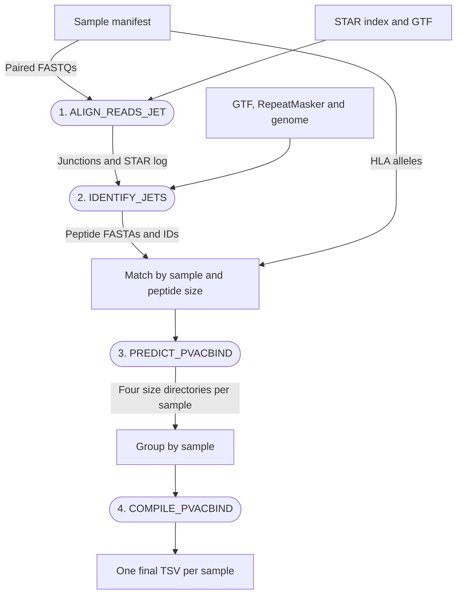

# NeonDisco-TEAL v2.1.0 | Nextflow JET Identification Pipeline

```
  ███╗   ██╗███████╗ ██████╗ ███╗   ██╗██████╗ ██╗███████╗ ██████╗ ██████╗
  ████╗  ██║██╔════╝██╔═══██╗████╗  ██║██╔══██╗██║██╔════╝██╔════╝██╔═══██╗
  ██╔██╗ ██║█████╗  ██║   ██║██╔██╗ ██║██║  ██║██║███████╗██║     ██║   ██║
  ██║╚██╗██║██╔══╝  ██║   ██║██║╚██╗██║██║  ██║██║╚════██║██║     ██║   ██║
  ██║ ╚████║███████╗╚██████╔╝██║ ╚████║██████╔╝██║███████║╚██████╗╚██████╔╝
  ╚═╝  ╚═══╝╚══════╝ ╚═════╝ ╚═╝  ╚═══╝╚═════╝ ╚═╝╚══════╝ ╚═════╝ ╚═════╝

  ████████╗███████╗ █████╗ ██╗
  ╚══██╔══╝██╔════╝██╔══██╗██║
     ██║   █████╗  ███████║██║
     ██║   ██╔══╝  ██╔══██║██║
     ██║   ███████╗██║  ██║███████╗
     ╚═╝   ╚══════╝╚═╝  ╚═╝╚══════╝
```

> **JET identification and MHC class I prediction from paired-end RNA-seq, adapted for human GRCh38.**  
> Based on the JET method described by Burbage, Rocañín-Arjó et al. in *Science Immunology* (2023).

NeonDisco-TEAL identifies splice junctions between exons and transposable elements (JETs), generates candidate peptides of 8–11 amino acids, and predicts how those peptides interact with each sample’s HLA class I alleles. The Nextflow workflow produces one combined table of filtered predictions per sample.

[Project overview](../README.md) · [Bash workflow](../JET_identification_pipeline/readme.md)

## Table of contents

1. [Workflow overview](#1-workflow-overview)
2. [Requirements](#2-requirements)
3. [Prepare the sample manifest](#3-prepare-the-sample-manifest)
4. [Run all four steps](#4-run-all-four-steps)
5. [Run individual steps](#5-run-individual-steps)
6. [Outputs and interpretation](#6-outputs-and-interpretation)
7. [View the workflow DAG](#7-view-the-workflow-dag)
8. [Logs, troubleshooting and resuming](#8-logs-troubleshooting-and-resuming)
9. [Citation and credits](#9-citation-and-credits)

## 1. Workflow overview

| Step | Nextflow process | What it does |
|---|---|---|
| **1. Align reads** | `BUILD_STAR_INDEX` (optional), `ALIGN_READS_JET` | Builds or reuses a shared STAR index, aligns each sample’s paired-end reads, and indexes the sorted BAM with samtools. |
| **2. Identify JETs** | `IDENTIFY_JETS` | Runs the JET R analysis using STAR junctions, the alignment log, a GTF and RepeatMasker annotation. Produces peptide FASTAs and matching ID tables for sizes 8–11. |
| **3. Predict peptide–HLA interactions** | `PREDICT_PVACBIND` | Matches each sample’s peptides with its own HLA alleles and runs one pVACbind task per peptide size. |
| **4. Compile filtered results** | `COMPILE_PVACBIND` | Combines the sample’s filtered pVACbind reports into one TSV and adds a `Size` column. |

### Why use Nextflow?

Each sample advances as its inputs become available. If `379T` finishes STAR alignment first, its R analysis can start while `378T` is still aligning. Likewise, Step 4 can compile `379T` as soon as its four pVACbind tasks finish. The number of tasks running simultaneously depends on the CPUs and memory available.

You can also run a single step on existing results, reuse eligible completed tasks with `-resume`, or import an individual process from [`modules/`](modules/) into another Nextflow workflow.

| Location | Purpose |
|---|---|
| [`main.nf`](main.nf) | Reads the inputs and connects the four stages through Nextflow channels. |
| [`modules/`](modules/) | Contains the individual Nextflow processes. |
| [`bin/`](bin/) | Contains the STAR, R and pVACbind scripts called by Steps 1–3. |
| [`nextflow.config`](nextflow.config) | Sets the executor, work directory and container profiles. |
| [`conf/base.config`](conf/base.config) | Defines image paths, reference defaults, task resources and reports. |

## 2. Requirements

**Run the commands in this guide from the repository root**, the directory containing `pixi.toml` and `NF_JET_identificatio_pipeline/`. On the development server:

```bash
cd /home/faramir/repos/neondisco-jet
```

On another machine, use the path where you cloned the repository. The absolute paths in the examples below belong to the development server.

### Software and containers

The workflow was developed with Nextflow 26.04.6 on Linux. Install the repository’s Pixi environment and check that Apptainer is available:

```bash
pixi install
pixi run nextflow -version
apptainer --version
```

| Step | Image | Tools used |
|---|---|---|
| 1 | `preproc.sif` | STAR 2.7.11b and samtools 1.22.1 in the tested image |
| 2 | `jet-r-4.5.3.sif` | R 4.5.3, Bioconductor 3.22, the JET R packages and the hg38 genome package |
| 3 | `pVACtools.sif` | pVACtools 7.1.2 in the tested image, configured predictors and local IEDB at `/opt/iedb` |
| 4 | Runs directly in Nextflow | Reads and combines TSV files using a native `exec:` process |

The images are stored under `/home/faramir/images` on the development server. To check them:

```bash
images=/home/faramir/images

apptainer exec "$images/preproc.sif" STAR --version
apptainer exec "$images/preproc.sif" samtools --version | head -n 1
apptainer test --cleanenv --contain "$images/jet-r-4.5.3.sif"
apptainer exec "$images/pVACtools.sif" pvacbind run --help
apptainer exec "$images/pVACtools.sif" ls -ld /opt/iedb
```

Step 3 requests NetMHCpan, NetMHCpanEL, MHCflurryEL, BigMHC_IM, PRIME and DeepImmuno. Predictor coverage varies by peptide length and HLA allele. The workflow uses local IEDB for binding prediction and enables `--netmhc-stab` for stability prediction. The stability calculation can require internet access.

**On another server**, update the image paths in [`conf/base.config`](conf/base.config) and the work directory and bind paths in [`nextflow.config`](nextflow.config). Make sure the containers can access the FASTQs, references and work directory, including the targets of any symlinks.

### Reference files

| Input | What to provide |
|---|---|
| `--starIndex` | An existing STAR index directory containing `Genome`, `SA`, `SAindex` and `genomeParameters.txt`. |
| `--genomeFa` | The genome FASTA when building a new STAR index. Use this in place of `--starIndex`. |
| `--gtf` | A gene annotation GTF matching the genome assembly. The example uses Ensembl GRCh38 release 115. |
| `--repeatsFile` | A reformatted RepeatMasker table matching the same assembly. Supply it once for the whole run. |
| `--genome` | Use `hg38` with the references and R image shown here. |

The RepeatMasker table contains the following columns in order: `genoName`, `genoStart`, `genoEnd`, `strand`, `repName`, `repClass`, `repFamily`. A table named `379T.repeatmasker_reformat.txt` can be shared by other hg38 samples because its contents describe the reference genome. [Reference preparation instructions](../JET_identification_pipeline/readme.md#5-reference-files-required)

## 3. Prepare the sample manifest

Create a **tab-separated file with a header** and one row per sample. Use absolute FASTQ paths, a unique sample name and the HLA alleles belonging to that sample. Write allele names with literal asterisks and separate them with commas.

Example for `379T`:

```tsv
sampleName	rnaFastq1	rnaFastq2	hlaAlleles
379T	/home/faramir/data/neondisco-jet/inputData/379T_R1_trim.fastq.gz	/home/faramir/data/neondisco-jet/inputData/379T_R2_trim.fastq.gz	HLA-A*11:01,HLA-A*02:03,HLA-B*13:01,HLA-B*38:02,HLA-C*07:02,HLA-C*03:04
```

### Multiple samples in one run

Add another row to the same manifest. In the example below, **replace the 378T paths and illustrative HLA alleles with the actual values for that sample**.

```tsv
sampleName	rnaFastq1	rnaFastq2	hlaAlleles
379T	/home/faramir/data/neondisco-jet/inputData/379T_R1_trim.fastq.gz	/home/faramir/data/neondisco-jet/inputData/379T_R2_trim.fastq.gz	HLA-A*11:01,HLA-A*02:03,HLA-B*13:01,HLA-B*38:02,HLA-C*07:02,HLA-C*03:04
378T	/data/reads/378T_R1_trim.fastq.gz	/data/reads/378T_R2_trim.fastq.gz	HLA-A*01:01,HLA-A*03:01,HLA-B*08:01,HLA-B*35:01,HLA-C*04:01,HLA-C*07:01
```

Save this as `infoDir/cohort_nf_manifest.tsv`. Run the same command as for one sample, changing `--manifestPath` to the cohort manifest and `--outputDir` to a new cohort output directory. Both samples share the STAR index, GTF and RepeatMasker table. Each gets its own prediction folders and final TSV.

## 4. Run all four steps

From the repository root:

```bash
data=/home/faramir/data/neondisco-jet
manifest="$PWD/infoDir/379T_nf_manifest.tsv"
out="$data/outputData/379T_nextflow_steps1to4"

pixi run nextflow run NF_JET_identificatio_pipeline/main.nf \
  -profile apptainer \
  --step all \
  --manifestPath "$manifest" \
  --starIndex "$data/starIndexes_2.7.11b/star_index" \
  --gtf "$PWD/inputData/Homo_sapiens.GRCh38.115.gtf" \
  --repeatsFile "$PWD/metadataDir/379T.repeatmasker_reformat.txt" \
  --genome hg38 \
  --outputDir "$out"
```

For this example, the final result is:

```text
/home/faramir/data/neondisco-jet/outputData/379T_nextflow_steps1to4/finalresult/379T/finalresult379T.tsv
```

**To build a STAR index**, replace the `--starIndex` line with `--genomeFa /path/to/GRCh38.fa` and set `--starIndexesDir` to the parent directory where the index should be saved. The default index folder name is `star_index`. Pass this completed folder to `--starIndex` on future runs.

## 5. Run individual steps

Use `--step 1`, `2`, `3` or `4` to run a stage independently. Steps 1–3 read a manifest. Standalone Step 4 takes one sample’s existing pVACbind results directory.

| Mode | Required manifest columns | Other inputs |
|---|---|---|
| `--step 1` | `sampleName`, `rnaFastq1`, `rnaFastq2` | `--gtf` and either `--starIndex` or `--genomeFa` |
| `--step 2` | `sampleName`, `starDir` | `--gtf`, `--repeatsFile`, `--genome hg38` |
| `--step 3` | `sampleName`, `jetDir`, `hlaAlleles` | Existing peptide FASTAs and matching ID tables under `jetDir` |
| `--step 4` | No manifest required | `--pvacbindDir` pointing to one sample’s results |

For **Step 2**, `starDir` must directly contain `<sample>_Chimeric.out.junction`, `<sample>_SJ.out.tab` and `<sample>_Log.final.out`. For **Step 3**, `jetDir` must directly contain the four matching `.fasta` and `.ids.txt` pairs for peptide sizes 8–11.

### Example: compile existing pVACbind results for 379T

Use this when Steps 1–3 have already finished. Point `--pvacbindDir` at the sample directory containing `pvacbind_size8`, `pvacbind_size9`, `pvacbind_size10` and `pvacbind_size11`. The compiler reads the sample name from the filtered report filenames.

```bash
data=/home/faramir/data/neondisco-jet/outputData

pixi run nextflow run NF_JET_identificatio_pipeline/main.nf \
  --step 4 \
  --pvacbindDir "$data/379T_nextflow/pVACbind/379T" \
  --outputDir "$data/379T_step4"
```

The result is `379T_step4/finalresult/379T/finalresult379T.tsv` under `$data`.

## 6. Outputs and interpretation

Paths below are relative to `--outputDir`.

| Path | Contents |
|---|---|
| `STAR-alignments/<sample>/processed_calls/` | Sorted BAM and BAM index, gene counts, chimeric junctions, splice junctions and the STAR final log |
| `JET-identification/<sample>/` | Annotated JET table, peptide FASTAs, peptide ID tables, genomic sequence tables and RData files |
| `pVACbind/<sample>/pvacbind_size<N>/MHC_Class_I/` | pVACbind reports for peptide length `<N>`, including all-epitope, filtered and aggregated TSVs when generated |
| `finalresult/<sample>/finalresult<sample>.tsv` | Combined filtered predictions for one sample |
| `reports/` | `execution_report.html`, `timeline.html` and `trace.txt` |

**How to read the final table.** The first column, `Size`, identifies the peptide length of each prediction. The remaining columns come from the original `*.MHC_I.filtered.tsv` reports. Step 4 matches columns by name, preserves the original score text and fills a cell with `NA` when that size’s report lacks the column. An existing `NA` is carried over from Step 3. Treat `NA` as an unavailable score.

Step 4 skips a size if its filtered report is missing. A report containing only a header contributes zero rows. Standalone compilation requires at least one filtered report with a valid header. Keep each size’s `.ids.txt` file to trace a prediction index back to its JET record.

## 7. View the workflow DAG

The diagram shows the full workflow using an existing STAR index. Arrows show which data the next process needs.



To generate the DAG from `main.nf` without running the analysis, use `-preview -with-dag` with the same input paths as a full run:

```bash
data=/home/faramir/data/neondisco-jet
preview="$data/outputData/379T_flowchart"
mkdir -p "$preview"

pixi run nextflow run NF_JET_identificatio_pipeline/main.nf \
  -profile apptainer \
  -preview -with-dag "$preview/flowchart.html" \
  --step all \
  --manifestPath "$PWD/infoDir/379T_nf_manifest.tsv" \
  --starIndex "$data/starIndexes_2.7.11b/star_index" \
  --gtf "$PWD/inputData/Homo_sapiens.GRCh38.115.gtf" \
  --repeatsFile "$PWD/metadataDir/379T.repeatmasker_reformat.txt" \
  --genome hg38 \
  --outputDir "$preview"
```

Open `flowchart.html` in a browser. The preview still checks the supplied manifest and reference paths.

## 8. Logs, troubleshooting and resuming

| Issue | What to check |
|---|---|
| `Index missing Genome` | Use the directory directly containing `Genome`, often `starIndexes_2.7.11b/star_index/`. |
| A task cannot read an input file | Check the absolute path in the manifest, Apptainer binds and the resolved target of any symlink. |
| A Step 4 run cannot find filtered reports | `--pvacbindDir` should be the sample folder immediately above `pvacbind_size8` through `pvacbind_size11`. Expected report names end in `.MHC_I.filtered.tsv`. |
| A predictor column contains `NA` | Check the original filtered TSV for that size to see whether the column was absent or the value was already missing. |
| A task fails | Read the error in the Nextflow log and check `reports/trace.txt`. For shell-based tasks, inspect `.command.sh` and `.command.err` in the reported work directory. |

To keep the Nextflow log outside the repository, set its location before launching:

```bash
mkdir -p "$HOME/nextflow-logs"
export NXF_LOG_FILE="$HOME/nextflow-logs/neondisco-teal.log"
```

To reuse eligible completed tasks after a failure, rerun the same command with `-resume` from the same launch directory. Keep the task cache and work directory. Step 4 uses `cache false`, so it rereads the filtered reports when the compiler runs.

## 9. Citation and credits

The original JET pipeline was developed by Alexandre Houy and Christel Goudot at Institut Curie, with modifications by Ares Rocañín-Arjó. Muhammad Faramir adapted the workflow for human GRCh38 and integrated pVACbind and multi-sample orchestration at Cancer Research Malaysia.

- Burbage M, Rocañín-Arjó A, et al. *Epigenetically-controlled tumor antigens derived from splice junctions between exons and transposable elements.* Science Immunology, 2023.
- Hundal J, et al. *pVACtools: a computational toolkit to identify and visualize cancer neoantigens.* Cancer Immunology Research, 2020.

See the [Bash pipeline guide](../JET_identification_pipeline/readme.md) for further background on the original implementation.
